# Lab 01: Lab environment and Harness Open Source

- [Lab 01: Lab environment and Harness Open Source](#lab-01-lab-environment-and-harness-open-source)
  - [Goals](#goals)
  - [Before you start](#before-you-start)
  - [Part 1: Look at your lab machine](#part-1-look-at-your-lab-machine)
    - [1.1 Check the operating system and resources](#11-check-the-operating-system-and-resources)
  - [Part 2: Install the base tools](#part-2-install-the-base-tools)
    - [2.1 Install git, curl and jq](#21-install-git-curl-and-jq)
    - [2.2 Tell Git who you are](#22-tell-git-who-you-are)
    - [2.3 Install Visual Studio Code](#23-install-visual-studio-code)
    - [2.4 Make VS Code end every file with a line break](#24-make-vs-code-end-every-file-with-a-line-break)
  - [Part 3: Install Docker](#part-3-install-docker)
    - [3.1 Add Docker's repository and install Docker Engine](#31-add-dockers-repository-and-install-docker-engine)
    - [3.2 Allow the local image registry](#32-allow-the-local-image-registry)
    - [3.3 Run Docker without sudo](#33-run-docker-without-sudo)
    - [3.4 Check that Docker works](#34-check-that-docker-works)
  - [Part 4: Run Harness Open Source](#part-4-run-harness-open-source)
    - [4.1 Create a network for the course containers](#41-create-a-network-for-the-course-containers)
    - [4.2 How Harness stores secrets](#42-how-harness-stores-secrets)
    - [4.3 Start Harness](#43-start-harness)
    - [4.4 Wait until Harness is ready](#44-wait-until-harness-is-ready)
    - [4.5 Sign in](#45-sign-in)
  - [Part 5: Create a project and a repository](#part-5-create-a-project-and-a-repository)
    - [5.1 Create the project](#51-create-the-project)
    - [5.2 Create the repository](#52-create-the-repository)
  - [Part 6: Push the starter application](#part-6-push-the-starter-application)
    - [6.1 Get the course files](#61-get-the-course-files)
    - [6.2 Copy the application into its own folder](#62-copy-the-application-into-its-own-folder)
    - [6.3 Read the application](#63-read-the-application)
    - [6.4 Create a personal access token](#64-create-a-personal-access-token)
    - [6.5 Store the token for Git](#65-store-the-token-for-git)
    - [6.6 Make the first commit](#66-make-the-first-commit)
    - [6.7 Push to Harness](#67-push-to-harness)
    - [6.8 Look at the repository in Harness](#68-look-at-the-repository-in-harness)
  - [Troubleshooting](#troubleshooting)
  - [Going further (optional)](#going-further-optional)
    - [A. Look at what Docker created](#a-look-at-what-docker-created)
    - [B. Use the Harness API](#b-use-the-harness-api)
    - [C. Clone over SSH](#c-clone-over-ssh)
  - [Summary](#summary)


In this lab you prepare your lab machine for the whole course. You install the command-line tools, Docker, and Harness Open Source, a self-hosted platform for Git repositories and pipelines. You then create a project and a repository in Harness and push the sample application that you will test, package and deploy over the next three days. By the end of the lab, your code is in a shared repository. Every change from Lab 02 onward goes through that repository.

**Lecture:** L1 DevOps foundations and L2 Version control and continuous integration · **You need:** a fresh lab machine. Nothing else.

## Goals

- Install software on Ubuntu from signed package repositories, and explain what each tool is for.
- Run Harness Open Source in a Docker container, and explain what each part of the `docker run` command does.
- Create a project and a Git repository in Harness.
- Push the starter application to the repository over HTTP, with a personal access token.

## Before you start

- Open this lab in the web browser on your lab machine. You can then copy each command with the copy button at the top right of every code block.
- Open a terminal: press Ctrl+Alt+T, or open Activities and search for Terminal.
- Paste into the terminal with Ctrl+Shift+V.
- When a step says "You should see", compare your output with the sample. Version numbers, times and IDs will differ a little.
- Some commands use `sudo`. The first time, it may ask for your password.

Check who you are and that you can use `sudo`:

```bash
whoami
sudo true && echo "sudo works"
```

You should see your user name and `sudo works`.

## Part 1: Look at your lab machine

### 1.1 Check the operating system and resources

This one machine runs a Git server, a pipeline engine, container builds and a Kubernetes cluster during the course. Each of them needs CPU, memory and disk. When you know what the machine has, later errors such as "no space left on device" are easier to understand.

- `cat /etc/os-release` shows the operating system and version.
- `nproc` shows the number of CPU cores.
- `free -h` shows the memory, in human-readable units.
- `df -h /` shows the disk space of the root filesystem.

```bash
cat /etc/os-release
nproc
free -h
df -h /
```

You should see Ubuntu 24.04, 8 CPU cores, about 15 GiB of memory, and more than 60 GB free on `/`:

```text
PRETTY_NAME="Ubuntu 24.04.3 LTS"
...
8
               total        used        free      shared  buff/cache   available
Mem:            15Gi       1.4Gi        12Gi        33Mi       1.9Gi        13Gi
...
Filesystem      Size  Used Avail Use% Mounted on
/dev/sda1        78G  7.1G   71G  10% /
```

## Part 2: Install the base tools

### 2.1 Install git, curl and jq

Ubuntu installs software from package repositories with `apt`. A package repository is a web server that offers packages. Each package is signed, so that `apt` can check that nobody changed it on the way. The desktop edition of Ubuntu does not include these tools:

- `git` is the version control tool. You use it to commit and push code.
- `curl` sends HTTP requests from the terminal. You use it to call APIs and to test the application.
- `jq` reads and filters JSON. Most APIs in this course answer with JSON.
- `ca-certificates` and `gnupg` hold the certificate authorities and the GPG tool. `apt` needs them to check the signatures of the extra repositories you add later.

`apt-get update` downloads the current list of available packages. `apt-get install -y` installs packages without asking for confirmation.

On some Ubuntu installations, a tool called `needrestart` opens a dialog after each installation and asks which services to restart. The first line below tells it to restart them without asking, so the installations in this course do not stop at a dialog. If your machine does not have `needrestart`, the line does nothing.

```bash
if [ -d /etc/needrestart/conf.d ]; then echo "\$nrconf{restart} = 'a';" | sudo tee /etc/needrestart/conf.d/90-course.conf > /dev/null; fi
sudo apt-get install -y git curl jq ca-certificates gnupg
git --version
curl --version | head -1
jq --version
```

You should see three version lines, for example:

```text
git version 2.43.0
curl 8.5.0 (x86_64-pc-linux-gnu) libcurl/8.5.0 ...
jq-1.7.1
```

### 2.2 Tell Git who you are

Every commit records an author name and email address. A shared repository shows them on each change, so the team knows who made it. You also set the name of the first branch in new repositories to `main`.

Replace the name and email address with your own before you run the commands.

```bash
git config --global user.name "Your Name"
git config --global user.email "you@example.com"
git config --global init.defaultBranch main
git config --global --list
```

You should see the three settings you just made.

### 2.3 Install Visual Studio Code

In this course you write YAML, Python, Terraform and Dockerfiles. An editor that highlights syntax helps you spot indentation mistakes, which are the most common cause of broken YAML. Visual Studio Code (VS Code) comes from Microsoft's own package repository.

The commands follow a pattern that you repeat later for Docker, kubectl, Terraform and Trivy:

1. Download the publisher's signing key and store it in `/etc/apt/keyrings`.
2. Add the repository to `/etc/apt/sources.list.d`. The `signed-by=` option tells `apt` to accept packages from this repository only if this key signed them.
3. Run `apt-get update` and install the package.

The `if` line skips the installation when VS Code is already installed. The `debconf-set-selections` line answers, in advance, a question that the VS Code package would otherwise ask during installation.

```bash
if ! command -v code >/dev/null; then
  echo "code code/add-microsoft-repo boolean false" | sudo debconf-set-selections
  wget -qO- https://packages.microsoft.com/keys/microsoft.asc | gpg --dearmor > /tmp/microsoft.gpg
  sudo install -D -o root -g root -m 644 /tmp/microsoft.gpg /etc/apt/keyrings/packages.microsoft.gpg
  echo "deb [arch=amd64,arm64,armhf signed-by=/etc/apt/keyrings/packages.microsoft.gpg] https://packages.microsoft.com/repos/code stable main" \
    | sudo tee /etc/apt/sources.list.d/vscode.list > /dev/null
  sudo apt-get update
  sudo apt-get install -y code
fi
code --version | head -1
```

You should see a version number, for example `1.105.1`. You can now start VS Code from the Activities menu, or from the terminal with `code` followed by a folder name. If you prefer a simpler editor, the Text Editor app that comes with Ubuntu also works for every lab.

### 2.4 Make VS Code end every file with a line break

In the labs you copy file contents with the copy button of a code block and paste them into VS Code. The copy button leaves out the line break after the last line. The Python checks in this course require every file to end with a line break, and VS Code does not add one by default. The setting `files.insertFinalNewline` makes VS Code add it each time you save.

The command creates the VS Code settings file with this setting, if you do not have a settings file yet. If you already have one, open **File** > **Preferences** > **Settings** in VS Code, search for `Insert Final Newline`, and turn it on.

```bash
mkdir -p ~/.config/Code/User
if [ ! -f ~/.config/Code/User/settings.json ]; then
  echo '{ "files.insertFinalNewline": true }' > ~/.config/Code/User/settings.json
fi
cat ~/.config/Code/User/settings.json
```

You should see `"files.insertFinalNewline": true` in the output. The Text Editor app adds the final line break by itself.

## Part 3: Install Docker

### 3.1 Add Docker's repository and install Docker Engine

Docker runs applications in containers. In this course almost everything runs in containers: Harness Open Source, every pipeline step, the Kubernetes cluster and the sample application. Ubuntu has its own `docker.io` package, but it is often older than Docker's own release. You install Docker CE (Community Edition) from Docker's repository, with the same signed-repository pattern as in step 2.3.

The install command pins Docker Engine to major version 29 (`'docker-ce=5:29.*'`). The course was tested with this version. A pin means that a new major release of Docker cannot change how the labs behave in the middle of the course. The other packages are:

- `containerd.io`, the container runtime that Docker uses to start containers.
- `docker-buildx-plugin`, the BuildKit image builder.
- `docker-compose-plugin`, Docker Compose, which you use on Day 3.

```bash
sudo install -m 0755 -d /etc/apt/keyrings
sudo curl -fsSL https://download.docker.com/linux/ubuntu/gpg -o /etc/apt/keyrings/docker.asc
sudo chmod a+r /etc/apt/keyrings/docker.asc
echo "deb [arch=$(dpkg --print-architecture) signed-by=/etc/apt/keyrings/docker.asc] https://download.docker.com/linux/ubuntu $(. /etc/os-release && echo "${UBUNTU_CODENAME:-$VERSION_CODENAME}") stable" \
  | sudo tee /etc/apt/sources.list.d/docker.list > /dev/null
sudo apt-get update
sudo apt-get install -y 'docker-ce=5:29.*' 'docker-ce-cli=5:29.*' containerd.io docker-buildx-plugin docker-compose-plugin
sudo docker version --format 'Docker Engine {{.Server.Version}}'
```

You should see `Docker Engine 29.` followed by a minor and patch version, for example `Docker Engine 29.9.2`.

### 3.2 Allow the local image registry

On Day 2 you create a small image registry on this machine, at `k3d-registry.localhost:5000`. A registry stores container images. This one uses plain HTTP, without TLS. Docker refuses to push images to a registry without TLS, unless the registry is listed under `insecure-registries` in `/etc/docker/daemon.json`.

You add the setting now. Changing it later needs a restart of Docker, and a restart also restarts every running container. Use this setting only for a registry on your own lab machine. A real registry always uses TLS.

```bash
echo '{ "insecure-registries": ["k3d-registry.localhost:5000"] }' | sudo tee /etc/docker/daemon.json
sudo systemctl restart docker
sudo docker info 2>/dev/null | grep -A3 'Insecure Registries'
```

You should see:

```text
 Insecure Registries:
  k3d-registry.localhost:5000
  ::1/128
  127.0.0.0/8
```

### 3.3 Run Docker without sudo

The Docker daemon runs as root. Its socket, `/var/run/docker.sock`, belongs to the `docker` group. Members of that group can use Docker without `sudo`. Membership is powerful: anyone who can use the Docker socket can start a container with root access to the whole machine. That is acceptable on your own lab machine. On a shared server, treat the `docker` group like root access.

`usermod -aG docker $USER` adds your user to the group.

```bash
sudo usermod -aG docker $USER
```

Your terminal does not see the new group yet, because Linux reads group membership when you log in. `newgrp docker` starts a new shell in this terminal with the group active. Run it on its own:

```bash
newgrp docker
```

The terminal looks the same, but you are now in a new shell. Terminal windows that you open later need `newgrp docker` too, until you log out and log back in, or restart the machine. If a `docker` command says "permission denied while trying to connect to the Docker daemon socket", run `newgrp docker` in that terminal.

### 3.4 Check that Docker works

`hello-world` is a tiny image that prints a message and exits. Running it checks the whole chain: the Docker command-line tool talks to the daemon, the daemon downloads (pulls) the image from Docker Hub, and starts a container from it. `--rm` deletes the container when it stops.

```bash
docker run --rm hello-world
docker version --format 'Client {{.Client.Version}}, server {{.Server.Version}}'
```

You should see `Hello from Docker!` with an explanation of the steps Docker took, and then the client and server versions.

<!-- test
docker info --format '{{.ServerVersion}}' | grep -q '^29\.'
docker info 2>/dev/null | grep -q 'k3d-registry.localhost:5000'
-->

## Part 4: Run Harness Open Source

### 4.1 Create a network for the course containers

Containers on the same user-defined Docker network can reach each other by container name. Docker runs a small DNS server for this. Harness starts every pipeline step as a container. You attach Harness, the pipeline steps and, on Day 2, the Kubernetes cluster to one network called `devops`. A pipeline step can then reach Harness or the cluster by name.

The `if` line creates the network only if it does not exist yet. You can run the block twice without an error.

```bash
if ! docker network inspect devops >/dev/null 2>&1; then
  docker network create devops
fi
docker network ls --filter name=devops
```

You should see one network named `devops` with the driver `bridge`.

### 4.2 How Harness stores secrets

In Labs 05 and 06 you store secrets in Harness, for example the credentials that a pipeline uses to deploy to Kubernetes. Harness Open Source can encrypt secrets in its database with a key that you pass in the setting `GITNESS_ENCRYPTER_SECRET`. In version 3.3.0, which this course uses, pipeline steps cannot read secrets that were stored with that setting: a step receives the encrypted bytes instead of the value. This course therefore starts Harness without an encryption key. Harness then stores secrets unencrypted in its database, in the `harness-data` volume. Lab 06 shows what that means, and how the Harness platform stores secrets instead.

### 4.3 Start Harness

Harness Open Source is one container image. It contains a Git server, a web interface, an API and a pipeline engine. Its settings still use the product's earlier name, Gitness. Read what each part of the command does before you run it:

| Part of the command | What it does |
|---|---|
| `-d` | Runs the container in the background (detached). |
| `--name harness` | Names the container. Containers on the `devops` network reach it as `harness`. |
| `--restart always` | Docker starts the container again after a crash or a restart of the machine. |
| `--network devops` | Connects the container to the network from step 4.1. |
| `-p 3000:3000 -p 3022:3022` | Makes the web interface and API (port 3000) and Git over SSH (port 3022) available on your machine. |
| `-v /var/run/docker.sock:/var/run/docker.sock` | Gives Harness access to your Docker daemon. Harness starts each pipeline step as a container on your machine. |
| `-v harness-data:/data` | Stores repositories, pipelines and secrets in a Docker volume. The data survives when the container is replaced. |
| `GITNESS_URL_CONTAINER` | The address that pipeline steps use to clone your repository: the container name `harness` on the `devops` network. |
| `GITNESS_CI_CONTAINER_NETWORKS` | Attaches every pipeline step container to the `devops` network. |
| `GITNESS_PRINCIPAL_ADMIN_EMAIL` and `GITNESS_PRINCIPAL_ADMIN_PASSWORD` | Create the administrator account the first time Harness starts. |
| `GITNESS_METRIC_ENABLED=false` | Turns off anonymous usage reporting. |
| `harness/harness:3.3.0` | The image and its version. A fixed version, instead of `latest`, means everyone in the class runs the same software. |

The administrator password is on the command line to keep this setup short. Anyone who can run `docker inspect harness` on this machine can read it. Lab 06 comes back to this problem.

```bash
docker run -d --name harness --restart always \
  --network devops \
  -p 3000:3000 -p 3022:3022 \
  -v /var/run/docker.sock:/var/run/docker.sock \
  -v harness-data:/data \
  -e GITNESS_URL_CONTAINER=http://harness:3000 \
  -e GITNESS_CI_CONTAINER_NETWORKS=devops \
  -e GITNESS_PRINCIPAL_ADMIN_EMAIL=admin@example.com \
  -e GITNESS_PRINCIPAL_ADMIN_PASSWORD=Harness-Lab-2026 \
  -e GITNESS_METRIC_ENABLED=false \
  harness/harness:3.3.0
```

Docker downloads the image and prints the ID of the new container, a long hexadecimal string.

### 4.4 Wait until Harness is ready

The container starts in a second, but Harness needs a few more seconds to create its database and the administrator account. The loop below calls the Harness API every 3 seconds until it answers. `curl -f` makes curl fail when the server answers with an HTTP error. `-s` hides curl's progress output.

```bash
until curl -fs http://localhost:3000/api/v1/system/config >/dev/null; do
  echo "Waiting for Harness..."
  sleep 3
done
echo "Harness is ready"
docker ps --filter name=harness --format '{{.Names}}  {{.Image}}  {{.Status}}'
```

You should see:

```text
Harness is ready
harness  harness/harness:3.3.0  Up 25 seconds
```

<!-- test
curl -fs http://localhost:3000/api/v1/system/config >/dev/null
docker inspect harness --format '{{.Config.Image}}' | grep -q '^harness/harness:3.3.0$'
-->

### 4.5 Sign in

Open http://localhost:3000 in the browser on your lab machine. The numbers in the screenshot match the steps below.

1. In the **Email / User ID** field, enter `admin`.
2. In the **Password** field, enter `Harness-Lab-2026`.
3. Select **Sign In**.


<!-- shots:begin -->
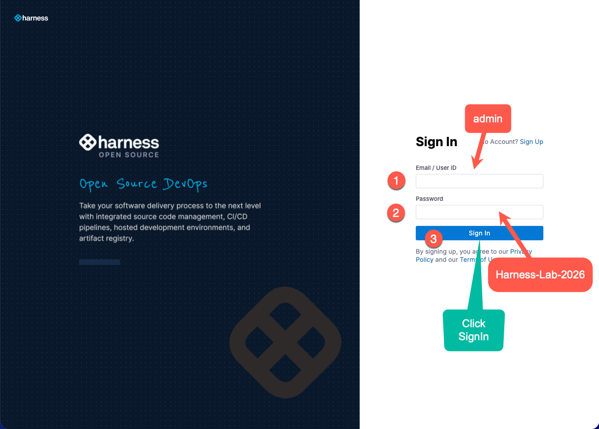
<!-- shots:end -->

<!-- ui: login -->

Take a minute to look around. In Harness Open Source, a **project** groups repositories, pipelines and secrets. The Harness platform that United uses has the same idea with more levels: an **account** contains **organizations**, and each organization contains **projects**. In both products, pipelines, secrets and access rights belong to a project.

## Part 5: Create a project and a repository

### 5.1 Create the project

A project groups everything that belongs to one product or team. You create one project for the flight status service and its infrastructure.

After you sign in, Harness shows the start page. The numbers in the screenshots match the steps below.

1. In the left navigation, **Select project here** opens the project selector. You can also create a project from there.
2. On the start page, select **New Project**.

<!-- shots:begin -->
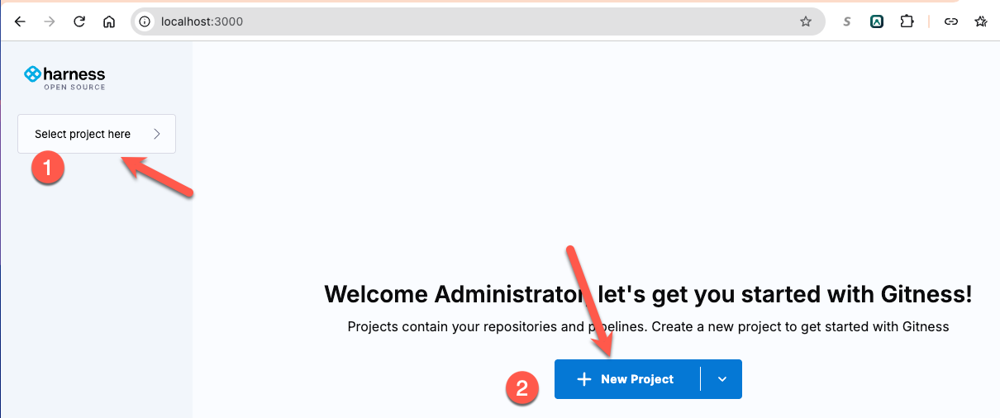
<!-- shots:end -->

In the **Create a project** dialog:

1. In the **Name** field, enter `flightops`.
2. In the **Description** field, enter `Flight Operations`.
3. Select **Create Project**.

Harness adds the project to the project list. Select `flightops` in the list to open it.

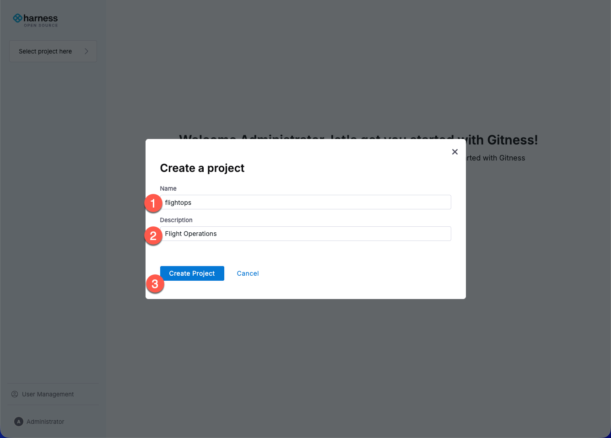

<!-- shots:end -->

<!-- ui: create_project flightops -->

<!-- test
h_api GET /api/v1/spaces/flightops | jq -e '.identifier == "flightops"' >/dev/null
-->

### 5.2 Create the repository

Inside the `flightops` project, the numbers in the first screenshot match these steps:

1. In the left navigation, select **Repositories**.
2. Select **New Repository**.

<!-- shots:begin -->
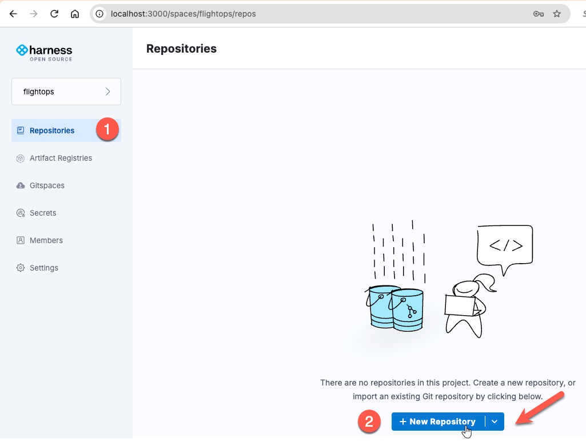
<!-- shots:end -->

In the **Create a repository** dialog, the numbers in the second screenshot match these steps:

1. In the **Name** field, enter `flight-status`.
2. In the **Description** field, enter `Flight Status`.
3. Keep **Private** selected.
4. Select **Create Repository**.

Leave the license, .gitignore and README options empty. You push existing code into this repository, and an empty repository avoids a merge between two unrelated histories. Keep `main` as the default branch.

<!-- shots:begin -->
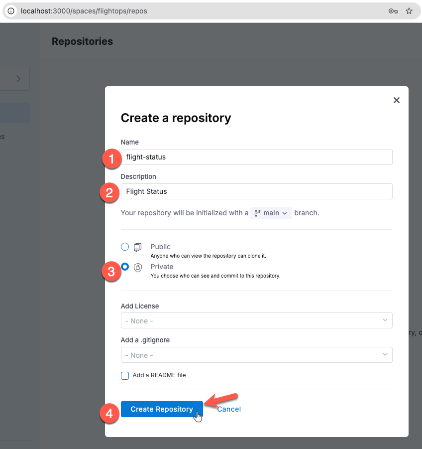
<!-- shots:end -->

<!-- ui: create_repo flightops flight-status -->

Harness shows the empty repository with instructions and its clone URL. The highlighted box in the screenshot lists two addresses for the same repository:

1. **HTTP**: `http://localhost:3000/git/flightops/flight-status.git`. This lab uses this address.
2. **SSH**: `ssh://git@localhost:3022/flightops/flight-status.git`. You do not use it in this lab.

Use the copy icon at the end of a field to copy the address.

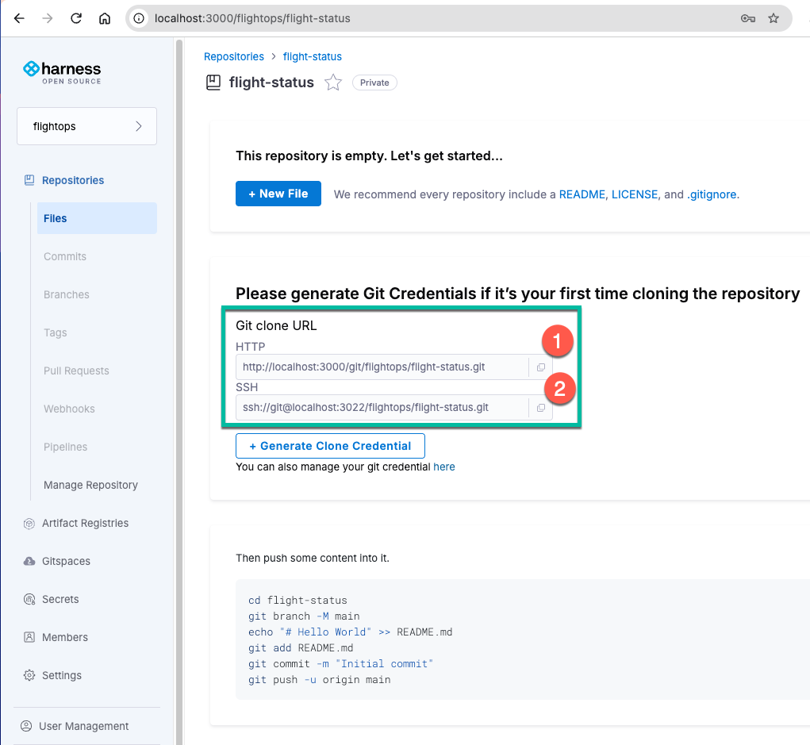

<!-- test
h_api GET /api/v1/repos/flightops%2Fflight-status | jq -e '.default_branch == "main"' >/dev/null
-->

## Part 6: Push the starter application

### 6.1 Get the course files

The course repository on GitHub holds the labs, the slides, the starter application and the reference solutions. You copy the application from it into your own repository in Harness. The `if` line skips the clone when the folder already exists, for example after the catch-up script.

```bash
if [ ! -d ~/intermediate-devops-companion ]; then
  git clone https://github.com/kpassoubady/intermediate-devops-companion.git ~/intermediate-devops-companion
fi
ls ~/intermediate-devops-companion
```

You should see folders such as `app`, `labs`, `scripts`, `slides` and `solutions`.

### 6.2 Copy the application into its own folder

In a real team, the application has its own repository. You copy the starter code into `~/flight-status` and turn that folder into a new Git repository. The `/.` at the end of the source path copies the content of the folder, including hidden files such as `.gitignore`.

```bash
mkdir -p ~/flight-status
cp -r ~/intermediate-devops-companion/app/. ~/flight-status/
cd ~/flight-status
find . -type f | sort
```

You should see these files (the order can differ):

```text
./.gitignore
./README.md
./flightstatus/__init__.py
./flightstatus/main.py
./flightstatus/models.py
./flightstatus/rules.py
./flightstatus/seed.py
./flightstatus/store.py
./pyproject.toml
./requirements-dev.txt
./requirements.txt
./tests/__init__.py
./tests/api/__init__.py
./tests/api/test_api.py
./tests/conftest.py
./tests/integration/__init__.py
./tests/integration/test_postgres.py
./tests/unit/__init__.py
./tests/unit/test_rules.py
```

<!-- shots:begin -->
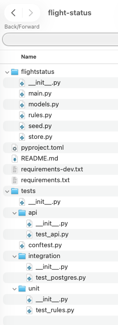
<!-- shots:end -->

### 6.3 Read the application

You test, package and deploy this service for three days. Look at its structure now.

```bash
cat README.md
sed -n '1,25p' flightstatus/rules.py
```

The service is a small web API for flight status:

- `flightstatus/models.py` defines a flight and the six statuses it can have.
- `flightstatus/rules.py` lists the allowed status changes. A flight can go from SCHEDULED to BOARDING, but not from SCHEDULED straight to ARRIVED.
- `flightstatus/store.py` keeps flights in memory, or in PostgreSQL when `DATABASE_URL` is set.
- `flightstatus/main.py` is the web API, built with the FastAPI framework.
- `tests/` holds unit tests, API tests and integration tests. Lab 03 explains the difference.
- `requirements.txt` and `requirements-dev.txt` list the dependencies with exact versions, so every installation gets the same packages.
- `pyproject.toml` configures the test runner (pytest) and the linter (ruff).

To open the folder in VS Code, run `code ~/flight-status`, or start VS Code and use File > Open Folder.

<!-- skip -->
```bash
code ~/flight-status
```

### 6.4 Create a personal access token

Git talks to Harness over HTTP, and Harness needs to know who you are. Instead of your password, you use a personal access token. A token is a long random string that works like a password, but it can expire, and you can delete it without changing your password. GitHub, GitLab and the Harness platform work the same way.

The numbers in the first screenshot match these steps:

1. At the bottom of the left navigation, select your user name (**Administrator**). Harness opens the **Account Setting** page.
2. In the **Personal Access Token** section, select **New Token**.

<!-- shots:begin -->
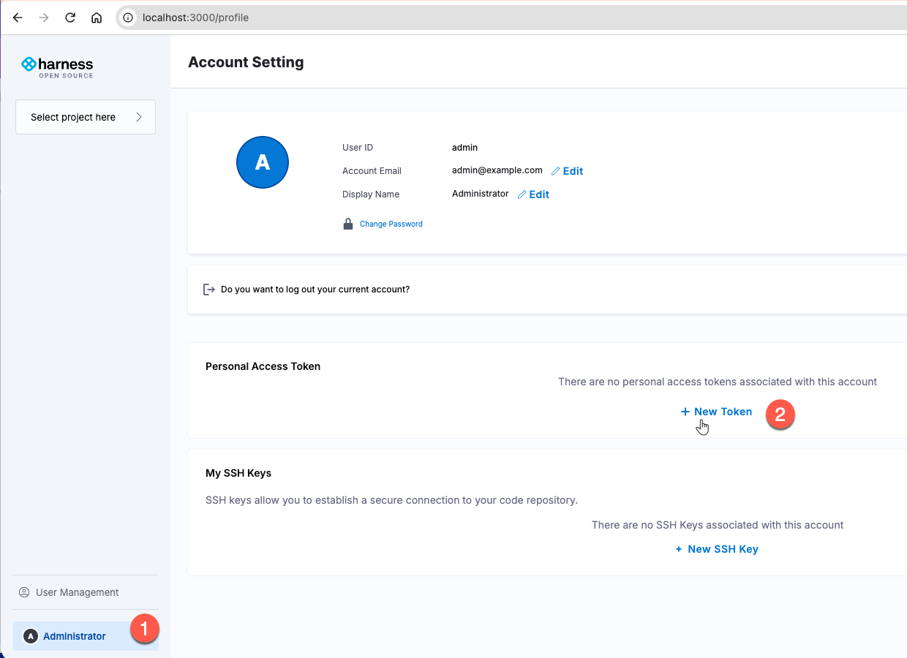
<!-- shots:end -->

The **Create a token** dialog opens. The numbers in the second screenshot match these steps:

1. In the **Name** field, enter `git`.
2. In the **Expiration** list, choose **30 Days**.
3. Select **Generate Token**.

<!-- shots:begin -->
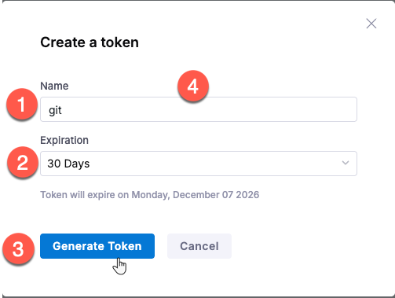
<!-- shots:end -->

Harness now shows the token. The numbers in the third screenshot match these steps:

1. Select the copy icon at the end of the **Token** field and copy the token now. The icon changes to a check mark. Harness shows the token only once, so paste it into a text file for the next step.
2. Select **Close** when you have copied the token.

<!-- shots:begin -->
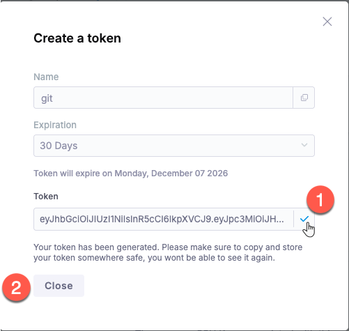
<!-- shots:end -->

<!-- ui: create_token git -->

### 6.5 Store the token for Git

Without a credential helper, Git asks for your user name and token on every push. The `store` helper saves them in the file `~/.git-credentials` after the first successful push. The file is plain text that your user can read. That is convenient for a lab, but anyone with access to your account can read the token. Lab 06 looks at this file again and discusses safer options, such as the keychain of the operating system.

```bash
git config --global credential.helper store
```

### 6.6 Make the first commit

`git init -b main` turns the folder into a Git repository with a branch called `main`. `git add .` stages every file for the next commit. `git commit` records the staged files as a commit, together with your name, your email address and a message that says what the change does.

```bash
cd ~/flight-status
git init -b main
git add .
git commit -m "Add the flight status service"
git log --oneline
```

You should see one commit with your message.

### 6.7 Push to Harness

`git remote add origin` stores the address of the Harness repository under the name `origin`. `git push -u origin main` sends your commits to the `main` branch there. `-u` remembers the connection, so from now on `git push` without arguments is enough.

When Git asks for credentials, enter:

- Username: `admin`
- Password: the token you copied in step 6.4. Paste it with Ctrl+Shift+V. The terminal does not show it.

```bash
git remote add origin http://localhost:3000/git/flightops/flight-status.git
git push -u origin main
```

You should see output that ends with:

```text
To http://localhost:3000/git/flightops/flight-status.git
 * [new branch]      main -> main
branch 'main' set up to track 'origin/main'.
```

<!-- test
test "$(git ls-remote origin refs/heads/main | cut -f1)" = "$(git rev-parse HEAD)"
grep -q '@localhost' ~/.git-credentials
-->

### 6.8 Look at the repository in Harness

Reload the `flight-status` repository page in Harness: http://localhost:3000/flightops/flight-status.

The numbers in the screenshot match these parts of the page:

1. The repository name, `flight-status`. The **Private** label means only members of the project can see it.
2. The branch selector. It shows `main`, the branch you pushed.
3. The latest commit: your name, the message `Add the flight status service`, and the short commit ID.
4. The files and folders of the repository, such as `flightstatus`, `tests`, `README.md` and `requirements.txt`. Each row shows the commit that last changed it. Right now that is your one commit for every row.
5. The content of `README.md`, which Harness displays below the file list.

The **Summary** panel on the right shows 1 commit and 1 branch.

<!-- shots:begin -->
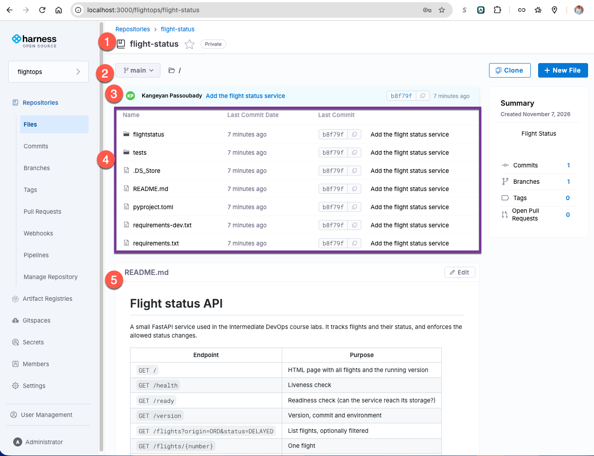
<!-- shots:end -->

<!-- ui: browse http://localhost:3000/flightops/flight-status -->

The repository in Harness is now the shared copy of the code. From Lab 02 on, every change you push to it starts automated checks.

## Troubleshooting

- **`permission denied while trying to connect to the Docker daemon socket`**: This terminal does not have the `docker` group yet. Run `newgrp docker` in it, or log out and log back in.
- **`E: Version '5:29.*' for 'docker-ce' was not found`**: The package list does not include Docker's repository. Check the repository line with `cat /etc/apt/sources.list.d/docker.list`, run `sudo apt-get update`, and run the install command again.
- **`Conflict. The container name "/harness" is already in use`**: The Harness container exists already. Check it with `docker ps -a --filter name=harness` and start it with `docker start harness`. To recreate it, run `docker rm -f harness` and the `docker run` command again. Your data stays in the `harness-data` volume.
- **The wait loop runs for more than two minutes**: Read the Harness log with `docker logs harness --tail 30`. A typo in one of the `-e` options is a common cause.
- **`git push` says `Authentication failed`**: The token was not pasted completely. Create a new token in Harness and run `git push -u origin main` again. If a wrong token was saved, delete the line that contains `localhost` in `~/.git-credentials` first. Git stores the address as `localhost%3a3000`.
- **`error: remote origin already exists`**: You ran `git remote add` twice. This is harmless. Check the address with `git remote -v`.
- **The browser cannot open http://localhost:3000**: Use the browser inside the lab machine, not on your own computer. Check that the container runs with `docker ps`.

<!-- runner: stop -->

## Going further (optional)

Each exercise stands alone. Run the commands in a terminal on the lab machine.

### A. Look at what Docker created

1. Show where Docker stores the Harness data on the disk. Look for the `Mountpoint` line in the output.

   ```bash
   docker volume inspect harness-data
   ```

2. List the containers that are connected to the course network.

   ```bash
   docker network inspect devops --format '{{range .Containers}}{{.Name}} {{end}}'
   ```

### B. Use the Harness API

Harness describes its API at http://localhost:3000/openapi.yaml. The web interface uses the same API.

1. Save your token in a variable. Run the command, paste the token (the terminal does not show it), and press Enter. If you no longer have the token, create a new one as in step 6.4.

   ```bash
   read -rs TOKEN
   ```

2. List the repositories of the `flightops` project. You should see `"flight-status"`.

   ```bash
   curl -s -H "Authorization: Bearer $TOKEN" http://localhost:3000/api/v1/spaces/flightops/repos | jq '.[].identifier'
   ```

### C. Clone over SSH

1. Create an SSH key. Press Enter at each question to accept the defaults.

   ```bash
   ssh-keygen -t ed25519
   ```

2. Show the public key and copy the whole line.

   ```bash
   cat ~/.ssh/id_ed25519.pub
   ```

3. In Harness, open your profile, select **SSH keys**, add a new key, and paste the line.
4. Open the `flight-status` repository page, select **Clone**, and copy the SSH URL.
5. Clone the repository into a new folder. Replace `<SSH-URL>` with the URL you copied.

   ```bash
   git clone <SSH-URL> /tmp/flight-status-ssh
   ```

6. Compare the two ways of authenticating: the token you stored in `~/.git-credentials` and the SSH key.

## Summary

- You installed software from signed package repositories with `apt`. Pinning Docker to major version 29 keeps the environment the same for everyone in the class.
- You ran Harness Open Source as a container and connected it to the `devops` network, which pipeline steps will share.
- You created a project and a repository. They match a project and a code repository in the Harness platform.
- You made the first commit and pushed it over HTTP with a personal access token. The repository in Harness is now the shared copy of the code that continuous integration will check.
