# Lab 05: Terraform in the pipeline

- [Lab 05: Terraform in the pipeline](#lab-05-terraform-in-the-pipeline)
  - [Goals](#goals)
  - [Before you start](#before-you-start)
  - [Part 1: Why the state must move](#part-1-why-the-state-must-move)
    - [1.1 The problems with a local state file](#11-the-problems-with-a-local-state-file)
    - [1.2 Create the objects Terraform needs before it can run](#12-create-the-objects-terraform-needs-before-it-can-run)
  - [Part 2: Move the state into the cluster](#part-2-move-the-state-into-the-cluster)
    - [2.1 Configure the backend](#21-configure-the-backend)
    - [2.2 Migrate the state](#22-migrate-the-state)
    - [2.3 Look at the stored state](#23-look-at-the-stored-state)
    - [2.4 Remove the local copy](#24-remove-the-local-copy)
    - [2.5 Commit the change](#25-commit-the-change)
    - [2.6 Open and merge the pull request](#26-open-and-merge-the-pull-request)
  - [Part 3: A credential for the pipeline](#part-3-a-credential-for-the-pipeline)
    - [3.1 Why the pipeline gets its own credential](#31-why-the-pipeline-gets-its-own-credential)
    - [3.2 Write the kubeconfig](#32-write-the-kubeconfig)
    - [3.3 Test it from your machine](#33-test-it-from-your-machine)
    - [3.4 Store it as a Harness secret](#34-store-it-as-a-harness-secret)
  - [Part 4: The infrastructure pipeline](#part-4-the-infrastructure-pipeline)
    - [4.1 Write the pipeline](#41-write-the-pipeline)
    - [4.2 Commit and push](#42-commit-and-push)
    - [4.3 Create the pipeline in Harness](#43-create-the-pipeline-in-harness)
    - [4.4 Add a push trigger](#44-add-a-push-trigger)
    - [4.5 Run it by hand](#45-run-it-by-hand)
  - [Part 5: Change infrastructure through a pull request](#part-5-change-infrastructure-through-a-pull-request)
    - [5.1 Make the change on a branch](#51-make-the-change-on-a-branch)
    - [5.2 Push the branch and open a pull request](#52-push-the-branch-and-open-a-pull-request)
    - [5.3 Review the plan](#53-review-the-plan)
    - [5.4 Merge](#54-merge)
    - [5.5 Check the cluster and update your copy](#55-check-the-cluster-and-update-your-copy)
  - [Part 6: Detect drift](#part-6-detect-drift)
    - [6.1 Change the quota by hand](#61-change-the-quota-by-hand)
    - [6.2 Run the pipeline](#62-run-the-pipeline)
    - [6.3 Read the plan](#63-read-the-plan)
    - [6.4 Correct the drift](#64-correct-the-drift)
  - [Part 7: How locking works](#part-7-how-locking-works)
  - [Troubleshooting](#troubleshooting)
  - [Going further (optional)](#going-further-optional)
  - [Summary](#summary)

At the end of Lab 04, the Terraform state is a file on your lab machine.
Nobody else can see it, nothing stops two people from changing it at the same time, and it contains database passwords.
In this lab you move the state into the cluster, give the pipeline its own credential, and build a Harness pipeline for the `platform` repository.
The pipeline checks and plans every pull request, and applies the change after the pull request is merged.
You then change the infrastructure through a pull request, and use the pipeline to detect drift.

**Lecture:** L7 Infrastructure as code in pipelines · **You need:** Lab 04.

On a fresh machine, clone the repository and run the catch-up script first:

<!-- skip -->
```bash
git clone https://github.com/kpassoubady/intermediate-devops-companion.git ~/intermediate-devops-companion
~/intermediate-devops-companion/scripts/catch-up.sh 05
```

## Goals

- Move Terraform state from a local file to a shared backend with locking.
- Create a separate credential for automation and store it as a Harness secret.
- Write a pipeline that plans every pull request and applies after merge.
- Review a Terraform plan in a pull request before the change reaches the cluster.
- Detect drift with a pipeline run.

## Before you start

Check that the cluster, the Terraform state and the `platform` repository from Lab 04 are in place.
The `export` line sets `KUBE_CONFIG_PATH` in this terminal, in case it was opened before you added it to `~/.bashrc`.

```bash
export KUBE_CONFIG_PATH=$HOME/.kube/config
cd ~/platform
kubectl get namespaces -l app.kubernetes.io/part-of=flightops
terraform state list
git status --short
git log --oneline -1
```

You should see the two flightops namespaces, 16 resource addresses, no output from `git status --short` (nothing uncommitted), and your Lab 04 commit.

```text
NAME             STATUS   AGE
flightops-dev    Active   1h
flightops-prod   Active   1h
kubernetes_limit_range_v1.env["dev"]
kubernetes_limit_range_v1.env["prod"]
kubernetes_namespace_v1.env["dev"]
...
module.postgres["prod"].random_password.db
4f6c2d1 Platform: k3d cluster, namespaces, quotas and databases
```

## Part 1: Why the state must move

### 1.1 The problems with a local state file

Look at the state file again:

```bash
ls -l terraform.tfstate
jq '[.resources[] | select(.type == "random_password")] | length' terraform.tfstate
```

```text
-rw-rw-r-- 1 student student 41230 Oct 28 10:41 terraform.tfstate
2
```

The second command counts the generated passwords stored in the file: one per environment.
A local state file has three problems:

1. **Only you have it.** A teammate who runs `terraform apply` from their machine has no state. Terraform would try to create every object again, and fail because the objects exist.
2. **No lock.** If two runs change the infrastructure at the same time, the second run works from an outdated state, and the state file can end up wrong.
3. **It holds secrets in plain text.** The passwords are in the file. Anyone who can read the file can read them.

A remote backend solves the first two problems.
It stores the state in a shared place, and it locks the state while a run changes it.
Here the backend is the Kubernetes cluster itself: the state goes into a Secret, and a Lease object acts as the lock.
At United on AWS, teams use an S3 bucket for Terraform state, or CloudFormation, which keeps its state inside AWS.
The third problem needs access control on the backend. Lab 06 looks at it.

### 1.2 Create the objects Terraform needs before it can run

The backend needs a namespace to store the state in.
The pipeline needs an identity (a ServiceAccount) and a token to log in to the cluster.
Terraform cannot create these objects itself, because it needs them in order to run.
This is the bootstrap problem: something has to exist before the automation can start.
The usual answer is a small set of objects that an administrator applies once by hand, kept in Git like any other code.

Create `~/platform/bootstrap/terraform-admin.yaml`:

Create directory:
```bash
mkdir -p ~/platform/bootstrap
```

touch the file:

```bash
touch ~/platform/bootstrap/terraform-admin.yaml
```

In VS Code copy and past the below code:

<!-- file: ~/platform/bootstrap/terraform-admin.yaml -->
```yaml
# Bootstrap objects for Terraform automation (Lab 05).
# An administrator applies this file once with kubectl. Terraform does not
# manage these objects, because it needs them before it can run.
apiVersion: v1
kind: Namespace
metadata:
  name: terraform
---
apiVersion: v1
kind: ServiceAccount
metadata:
  name: terraform
  namespace: terraform
---
# cluster-admin allows every action in the whole cluster. Terraform needs wide
# rights here because it creates namespaces. Protect this credential (Lab 06).
apiVersion: rbac.authorization.k8s.io/v1
kind: ClusterRoleBinding
metadata:
  name: terraform-admin
roleRef:
  apiGroup: rbac.authorization.k8s.io
  kind: ClusterRole
  name: cluster-admin
subjects:
  - kind: ServiceAccount
    name: terraform
    namespace: terraform
---
# A long-lived token for the ServiceAccount. Kubernetes writes the token into
# this Secret after it is created.
apiVersion: v1
kind: Secret
metadata:
  name: terraform-token
  namespace: terraform
  annotations:
    kubernetes.io/service-account.name: terraform
type: kubernetes.io/service-account-token
```

The file has four objects, separated by `---`:

| Object | Purpose |
|---|---|
| Namespace `terraform` | Holds the state Secret, the lock and the pipeline identity. |
| ServiceAccount `terraform` | The identity the pipeline uses. Kubernetes ServiceAccounts are identities for programs, as user accounts are for people. |
| ClusterRoleBinding `terraform-admin` | Grants the built-in `cluster-admin` role to that ServiceAccount. |
| Secret `terraform-token` | Kubernetes fills it with a token for the ServiceAccount, plus the cluster's CA certificate. |

`kubectl apply` is declarative: it creates objects that are missing and updates objects that differ.
Running it twice is safe.

```bash
kubectl apply -f ~/platform/bootstrap/terraform-admin.yaml
kubectl -n terraform get serviceaccount,secret
kubectl auth can-i create namespaces --as=system:serviceaccount:terraform:terraform
```

```text
namespace/terraform created
serviceaccount/terraform created
clusterrolebinding.rbac.authorization.k8s.io/terraform-admin created
secret/terraform-token created
NAME                       SECRETS   AGE
serviceaccount/default     0         2s
serviceaccount/terraform   0         2s

NAME                     TYPE                                  DATA   AGE
secret/terraform-token   kubernetes.io/service-account-token   3      2s
yes
```

`kubectl auth can-i ... --as=...` asks the cluster whether another identity may do something.
The answer `yes` confirms the binding.
`DATA 3` on the Secret means Kubernetes added the token, the CA certificate and the namespace.

## Part 2: Move the state into the cluster

### 2.1 Configure the backend

A `backend` block tells Terraform where to keep the state.
Without one, Terraform uses the local file.

Create `~/platform/backend.tf`:

```bash
touch ~/platform/backend.tf
```

In the file, add the following content:

<!-- file: ~/platform/backend.tf -->
```hcl
# Store the state in a Kubernetes Secret (tfstate-default-platform) in the
# "terraform" namespace. The backend uses a Lease object as the state lock.
# It reads the kubeconfig file named in KUBE_CONFIG_PATH.
terraform {
  backend "kubernetes" {
    secret_suffix = "platform"
    namespace     = "terraform"
  }
}
```

The Secret's name is built from the workspace name (`default`) and the suffix: `tfstate-default-platform`.
The backend reads the cluster connection from `KUBE_CONFIG_PATH`, the same variable the provider uses.
On your machine it points to your admin kubeconfig. In the pipeline it points to the pipeline's kubeconfig.

### 2.2 Migrate the state

Changing the backend requires `terraform init`.
`-migrate-state` tells Terraform to copy the existing local state into the new backend.
Terraform would normally ask "Do you want to copy existing state to the new backend?".
`-force-copy` answers yes, so the command runs without a prompt.

```bash
cd ~/platform
terraform init -migrate-state -force-copy
```

```text
Initializing the backend...
Terraform has detected that the configuration specified for the backend
has changed. Terraform will now check for existing state in the backends.

Successfully configured the backend "kubernetes"! Terraform will automatically
use this backend unless the backend configuration changes.
...
Terraform has been successfully initialized!
```

### 2.3 Look at the stored state

```bash
kubectl -n terraform get secrets,leases
```

```text
NAME                              TYPE                                  DATA   AGE
secret/terraform-token            kubernetes.io/service-account-token   3      3m
secret/tfstate-default-platform   Opaque                                1      20s

NAME                                                      HOLDER   AGE
lease.coordination.k8s.io/lock-tfstate-default-platform            20s
```

The Secret holds the state. The Lease is the lock. Its `HOLDER` is empty while no run holds the lock.

The backend compresses the state with gzip before it stores it, and Kubernetes encodes Secret data in base64.
Decode both layers and list the resources in the stored state:

```bash
kubectl -n terraform get secret tfstate-default-platform -o jsonpath='{.data.tfstate}' | base64 -d | gunzip | jq -r '.resources[] | "\(.module // "root")  \(.type).\(.name)"'
```

```text
root  kubernetes_limit_range_v1.env
root  kubernetes_namespace_v1.env
root  kubernetes_resource_quota_v1.env
module.postgres["dev"]  kubernetes_deployment_v1.db
module.postgres["dev"]  kubernetes_persistent_volume_claim_v1.db
...
module.postgres["prod"]  random_password.db
```

Anyone who can read this Secret can read the whole state, including the passwords.
Lab 06 looks at who that is.

### 2.4 Remove the local copy

Terraform no longer uses `terraform.tfstate`, but the file is still on disk with the passwords in it.
Delete it and its backup.
Then run a plan: Terraform now reads the state from the cluster.

```bash
cd ~/platform
rm -f terraform.tfstate terraform.tfstate.backup
terraform plan
```

```text
module.postgres["dev"].random_password.db: Refreshing state... [id=none]
module.postgres["prod"].random_password.db: Refreshing state... [id=none]
kubernetes_namespace_v1.env["prod"]: Refreshing state... [id=flightops-prod]
kubernetes_namespace_v1.env["dev"]: Refreshing state... [id=flightops-dev]
kubernetes_resource_quota_v1.env["dev"]: Refreshing state... [id=flightops-dev/quota]
module.postgres["dev"].kubernetes_persistent_volume_claim_v1.db: Refreshing state... [id=flightops-dev/postgres-data]
module.postgres["dev"].kubernetes_secret_v1.db: Refreshing state... [id=flightops-dev/flight-status-db]
kubernetes_limit_range_v1.env["dev"]: Refreshing state... [id=flightops-dev/defaults]
module.postgres["prod"].kubernetes_secret_v1.db: Refreshing state... [id=flightops-prod/flight-status-db]
kubernetes_resource_quota_v1.env["prod"]: Refreshing state... [id=flightops-prod/quota]
kubernetes_limit_range_v1.env["prod"]: Refreshing state... [id=flightops-prod/defaults]
module.postgres["dev"].kubernetes_service_v1.db: Refreshing state... [id=flightops-dev/postgres]
module.postgres["prod"].kubernetes_persistent_volume_claim_v1.db: Refreshing state... [id=flightops-prod/postgres-data]
module.postgres["prod"].kubernetes_service_v1.db: Refreshing state... [id=flightops-prod/postgres]
module.postgres["prod"].kubernetes_deployment_v1.db: Refreshing state... [id=flightops-prod/postgres]
module.postgres["dev"].kubernetes_deployment_v1.db: Refreshing state... [id=flightops-dev/postgres]

No changes. Your infrastructure matches the configuration.
```

<!-- test
cd ~/platform
test ! -f terraform.tfstate
terraform plan -detailed-exitcode > /dev/null
kubectl -n terraform get secret tfstate-default-platform > /dev/null
-->

If the plan wanted to create every resource, Terraform did not find the state. See Troubleshooting.

### 2.5 Commit the change

The backend configuration and the bootstrap file are part of the platform code.
Commit them on a branch, and merge them through a pull request, as you did for `flight-status` in Lab 03.

> [!IMPORTANT]
> Name the files in `git add`, as the commands below do. `git add .` stages everything in the folder, including files that you did not mean to commit. Run `git status --short` before you commit, and check that only `backend.tf` and the `bootstrap/` files are listed.

```bash
cd ~/platform
git switch -c store-tf-state
git add backend.tf bootstrap/
git commit -m "Store Terraform state in the cluster"
git push -u origin store-tf-state
```

The output will like the below one:

```text
....
....
remote: 
remote: Create a pull request for "store-tf-state" by visiting:
remote:   http://localhost:3000/flightops/platform/pulls/compare/main...store-tf-state
remote: 
To http://localhost:3000/git/flightops/platform.git
 * [new branch]      store-tf-state -> store-tf-state
branch 'store-tf-state' set up to track 'origin/store-tf-state'.
```

> [!NOTE]
> The `-u` option makes `origin/store-tf-state` the upstream of your local branch, so a later `git push` or `git pull` on this branch needs no arguments. The `remote:` lines in the output show the link for opening a pull request.


### 2.6 Open and merge the pull request

Harness shows a banner for the branch you just pushed. Select **Compare & pull request** (1).
If the banner is not there, open **Repositories** > **platform** > **Pull Requests** > **New Pull Request**, and choose `store-tf-state` as the source branch and `main` as the target.

<!-- shots:begin -->
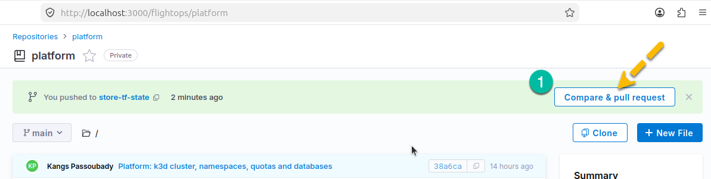

The title `Store Terraform state in the cluster` is already filled in. Check it, then select **Create pull request** (1).

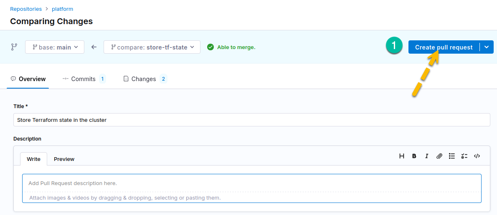

On the pull request page, select **Squash and merge** (1).

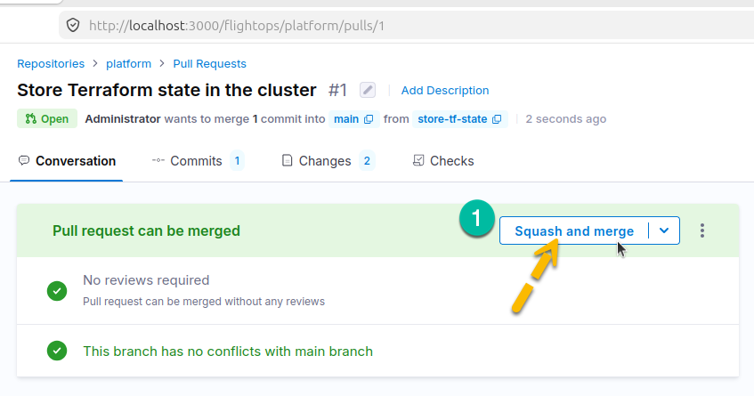

In the dialog, select **Confirm Squash and merge**.

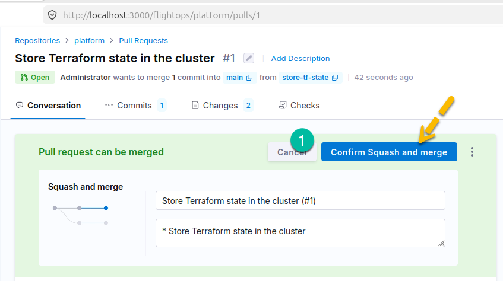

The pull request shows **Merged**.

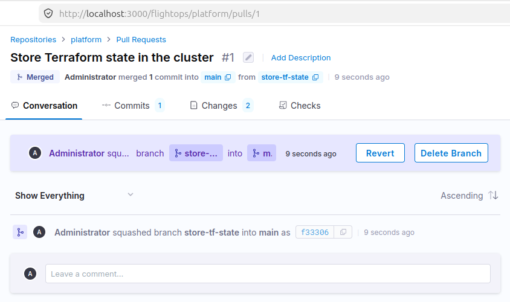
<!-- shots:end -->

Update your local copy and delete the branch:

```bash
git switch main
git pull
git branch -D store-tf-state
```

> [!NOTE]
> Deleting a branch after its pull request is merged is normal practice, and it is safe.
> A branch is only a movable label on a commit. Your changes are already in `main` through the squash merge, so deleting the label removes nothing.
> Git asks for `-D` here because a squash merge creates a new commit, so Git cannot see that `store-tf-state` was merged.
> To clean up the remote copy as well, select **Delete Branch** on the merged pull request page.
> Merging without deleting leaves stale branches that make it harder to see which work is still open.


## Part 3: A credential for the pipeline

### 3.1 Why the pipeline gets its own credential

Your `~/.kube/config` holds the cluster's administrator certificate, created by k3d.
The pipeline should not use your personal credential:

- You cannot take it away from the pipeline without taking it away from yourself.
- The cluster's audit records cannot tell your actions apart from the pipeline's actions.

The pipeline uses the `terraform` ServiceAccount instead.
You write a kubeconfig file for it with three parts:

- the API server address,
- the CA certificate that proves the server is genuine,
- the ServiceAccount token that identifies the client.

The address is different from yours.
Pipeline steps run in containers on the `devops` Docker network.
From there, the API server is `https://k3d-devops-serverlb:6443`: the load balancer's container name and its internal port.
Your machine reaches the same server through the published port, `https://0.0.0.0:6550`.

### 3.2 Write the kubeconfig

The first two commands read the token and the CA certificate from the Secret.
The token is stored in base64, so it is decoded.
The CA certificate stays in base64, because the kubeconfig format expects it that way.
`touch` and `chmod 600` create the file so that only you can read it, before any secret goes into it.

```bash
TOKEN=$(kubectl -n terraform get secret terraform-token -o jsonpath='{.data.token}' | base64 -d)
CA=$(kubectl -n terraform get secret terraform-token -o jsonpath='{.data.ca\.crt}')
touch ~/platform.kubeconfig && chmod 600 ~/platform.kubeconfig
cat > ~/platform.kubeconfig <<EOF
apiVersion: v1
kind: Config
clusters:
- name: devops
  cluster:
    server: https://k3d-devops-serverlb:6443
    certificate-authority-data: ${CA}
users:
- name: terraform
  user:
    token: ${TOKEN}
contexts:
- name: terraform
  context:
    cluster: devops
    user: terraform
current-context: terraform
EOF
unset TOKEN CA
ls -l ~/platform.kubeconfig
```

```text
-rw------- 1 student student 1720 Oct 28 10:55 /home/student/platform.kubeconfig
```

The file is outside the `platform` repository on purpose. It must never be committed.

### 3.3 Test it from your machine

Your machine cannot resolve the name `k3d-devops-serverlb`, so override the server address for this test.
`kubectl auth whoami` shows the identity that the API server sees.

```bash
kubectl --kubeconfig ~/platform.kubeconfig --server https://0.0.0.0:6550 auth whoami
```

```text
ATTRIBUTE                                           VALUE
Username                                            system:serviceaccount:terraform:terraform
UID                                                 3c9e...
Groups                                              [system:serviceaccounts system:serviceaccounts:terraform system:authenticated]
```

### 3.4 Store it as a Harness secret

A Harness secret keeps a value outside the repository.
Pipelines refer to it by name with `${{ secrets.get("name") }}`.
Harness Open Source 3.3.0 stores the value unencrypted in its database (Lab 01, step 4.2). Lab 06 shows why that matters.

Open the file in VS Code, select all (Ctrl+A) and copy (Ctrl+C):

<!-- skip -->
```bash
code ~/platform.kubeconfig
```

<!-- shots:begin -->
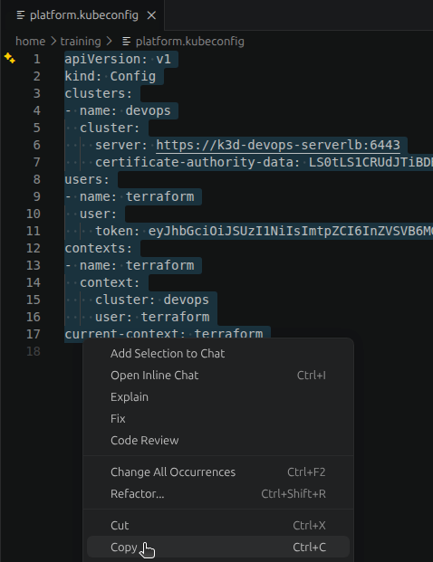

In the Harness UI, open the `flightops` project and select **Secrets** (1), then **New Secret** (2). The URL ends in `/secrets/flightops` (3), which confirms the project.

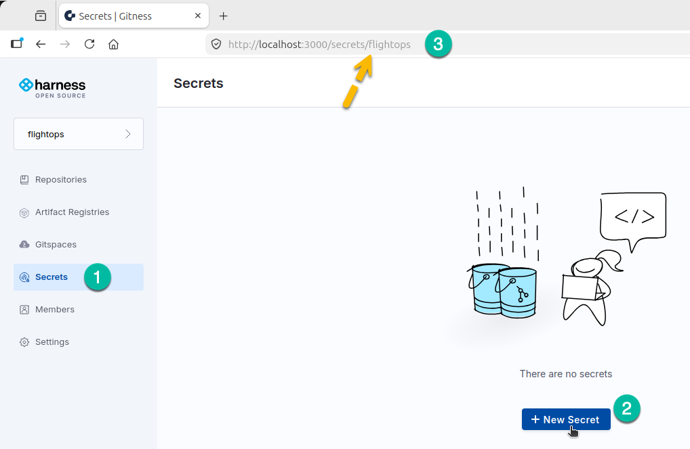

In the **Create a secret** dialog, enter `platform_kubeconfig` in **Name** (1) and paste the file content into **Value** (2). **Show Value** (3) is checked, so the pasted text stays visible. **Description** (4) is optional. Select **Create Secret** (5).

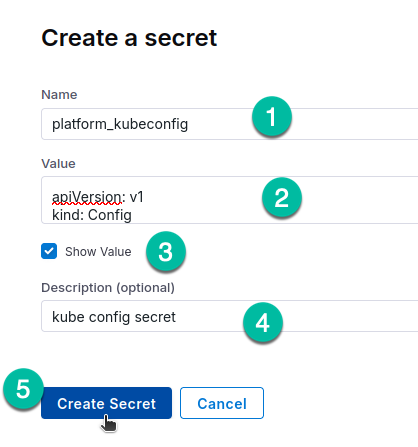

Harness shows **Secret created successfully** and lists `platform_kubeconfig` on the Secrets page.

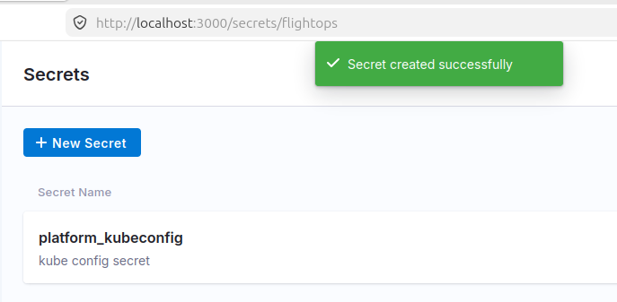

<!-- shots:end -->

<!-- ui: create_secret flightops platform_kubeconfig @~/platform.kubeconfig -->

In the Harness platform, a Kubernetes cluster connector holds this kind of credential, and the platform also offers external secret managers.
The pipeline refers to the connector instead of a pasted kubeconfig.

## Part 4: The infrastructure pipeline

### 4.1 Write the pipeline

Create `~/platform/.harness/infra.yaml`:

```bash
mkdir -p ~/platform/.harness
```

<!-- file: ~/platform/.harness/infra.yaml -->
```yaml
# Terraform pipeline for the platform repository (Lab 05).
# Pull requests: check formatting, validate and show the plan.
# Pushes to main (merged pull requests): apply the changes.
kind: pipeline
spec:
  stages:
  - name: terraform
    type: ci
    spec:
      envs:
        KUBE_CONFIG_PATH: /tmp/kubeconfig
        TF_IN_AUTOMATION: "true"
        TF_INPUT: "false"
      steps:
      - name: plan
        type: run
        spec:
          container: hashicorp/terraform:1.17.0
          envs:
            KUBECONFIG_CONTENT: ${{ secrets.get("platform_kubeconfig") }}
          script: |
            printf '%s\n' "$KUBECONFIG_CONTENT" > "$KUBE_CONFIG_PATH"
            terraform fmt -check -recursive
            terraform init
            terraform validate
            terraform plan -lock-timeout=60s
      - name: apply
        type: run
        when: build.event == "push" and build.target == "main"
        spec:
          container: hashicorp/terraform:1.17.0
          envs:
            KUBECONFIG_CONTENT: ${{ secrets.get("platform_kubeconfig") }}
          script: |
            printf '%s\n' "$KUBECONFIG_CONTENT" > "$KUBE_CONFIG_PATH"
            terraform init
            terraform apply -auto-approve -lock-timeout=60s
```

How it works:

| Part | What it does |
|---|---|
| Stage `envs` | Variables for every step in the stage. `KUBE_CONFIG_PATH` tells Terraform where the kubeconfig will be. `TF_IN_AUTOMATION` stops Terraform from suggesting commands to type next, which make no sense in a pipeline log. `TF_INPUT: "false"` makes Terraform fail instead of waiting for input that nobody can type. |
| `container: hashicorp/terraform:1.17.0` | The same Terraform version you installed. The step needs nothing else on the lab machine. |
| Step `envs` with `secrets.get` | Harness reads the secret at run time and passes it to the container as an environment variable. |
| `printf ... > "$KUBE_CONFIG_PATH"` | Writes the kubeconfig to a file inside the container. Each step is a new container, so each step writes the file again. The file is in `/tmp` inside the container, outside the shared workspace, so later steps cannot read it by accident. |
| `plan` script | Checks formatting, downloads the providers (`init`), validates, and plans. `-lock-timeout=60s` waits up to a minute if another run holds the lock, instead of failing at once. |
| `when` on `apply` | The apply step runs only for a push to `main`. Pull requests, manual runs and pushes to other branches stop after the plan. |

`terraform init` in the apply step is fast.
The steps share the workspace, so the providers that the plan step downloaded into `.terraform/` are still there.

### 4.2 Commit and push

Commit the pipeline on a branch, and merge it through a pull request, as in steps 2.5 and 2.6.

```bash
cd ~/platform
git switch -c add-infra-pipeline
git add .harness/infra.yaml
git commit -m "Add the infra pipeline"
git push -u origin add-infra-pipeline
```

The output at the end will contain as follows:

```text
...
...
remote: 
remote: Create a pull request for "add-infra-pipeline" by visiting:
remote:   http://localhost:3000/flightops/platform/pulls/compare/main...add-infra-pipeline
remote: 
To http://localhost:3000/git/flightops/platform.git
 * [new branch]      add-infra-pipeline -> add-infra-pipeline
branch 'add-infra-pipeline' set up to track 'origin/add-infra-pipeline'.
```

Open a pull request from `add-infra-pipeline` to `main`, and squash merge it.
Follow the same steps as step 2.6, and refer to the screenshots in that step if you need them.
The pipeline does not exist in Harness yet, so this pull request does not start a run.
> [!WARNING]
> `git branch -D` deletes the branch even though Git does not see it as merged. Run it only after the pull request shows **Merged**.

Update your local copy and delete the branch:

```bash
git switch main
git pull
git branch -D add-infra-pipeline
```

The output will contain:

```text
Switched to branch 'main'
...
...
Fast-forward
 .harness/infra.yaml | 37 +++++++++++++++++++++++++++++++++++++
 1 file changed, 37 insertions(+)
 create mode 100644 .harness/infra.yaml
Deleted branch add-infra-pipeline (was 55e58f6).
```

### 4.3 Create the pipeline in Harness

<!-- shots:begin -->
In the Harness UI, make sure the **flightops** project (1) is selected. Open **Repositories** (2) > **platform** > **Pipelines** (3), and select **New Pipeline** (4). The URL ends in `/flightops/platform/pipelines` (5).

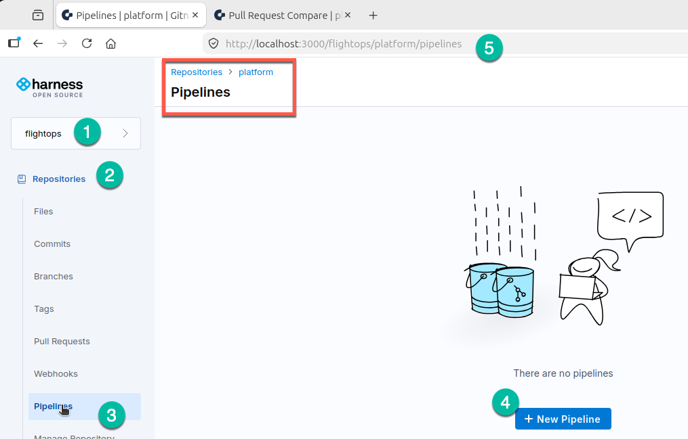

Enter the name `infra`, keep the branch `main`, and set the YAML path to `.harness/infra.yaml`. Select **Create**.

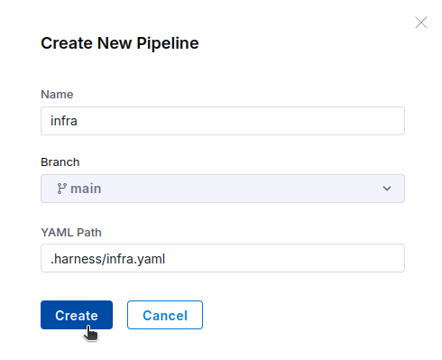

Harness opens the `infra` pipeline editor and shows the YAML from the file.

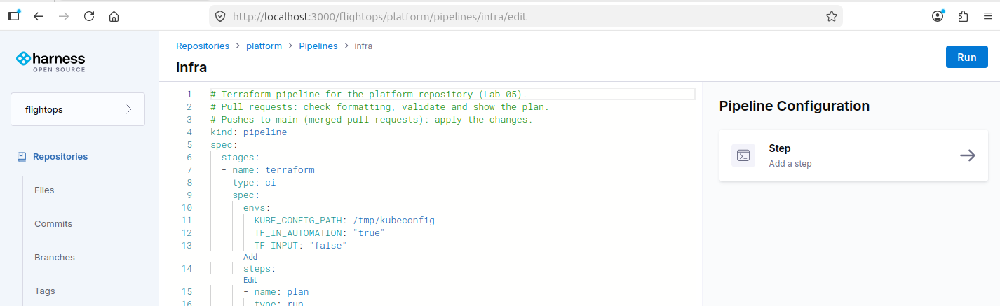
<!-- shots:end -->

<!-- ui: create_pipeline flightops/platform infra .harness/infra.yaml -->

Harness adds a default trigger that runs the pipeline for pull request events.

### 4.4 Add a push trigger

The apply step needs a push to `main`, so the pipeline needs a push trigger as well.

<!-- shots:begin -->
In the **Pipelines** list, select the `infra` pipeline.

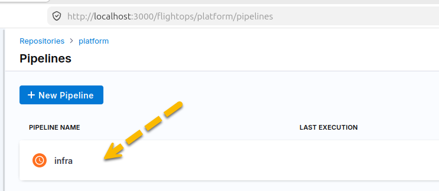

On the **Executions** page, the sidebar shows **Pipelines** (1) and the breadcrumb shows `infra` (2). Select **Pipeline Settings** (3).

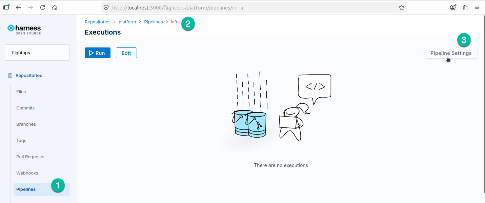

Open the **Triggers** tab and select **New Trigger**. The list holds only the `default` trigger.

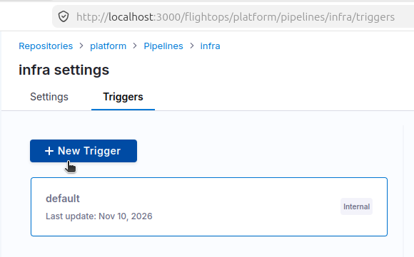

Enter the name `push`, check **Branch Updated**, and select **Create**.

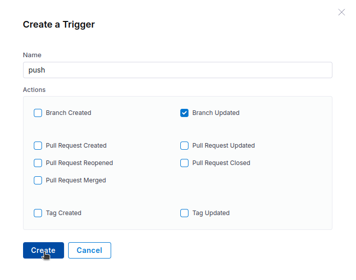

Harness shows **Trigger created successfully**, and `push` appears next to `default`.

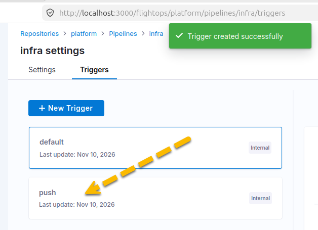
<!-- shots:end -->

<!-- ui: add_trigger flightops/platform infra push branch_updated -->

### 4.5 Run it by hand

On the **Executions** page of `infra`, check that **Pipelines** (1) is selected in the sidebar and `infra` (2) is in the breadcrumb. Select **Run** (3).

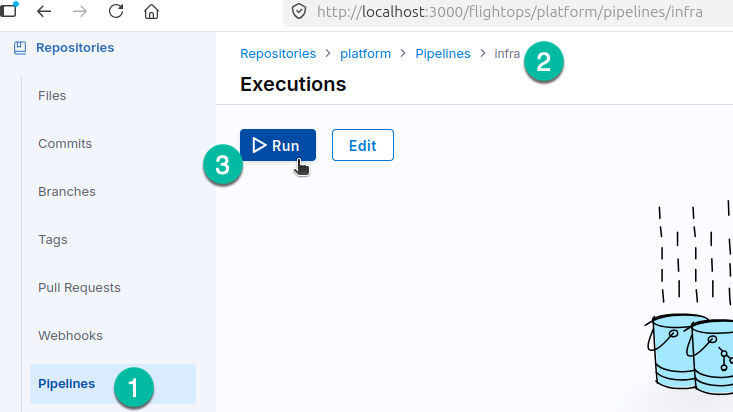

In the **Run pipeline** dialog, keep the branch `main` and select **Run pipeline** (1).

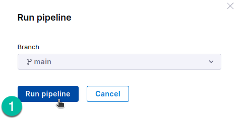

<!-- ui: run_pipeline flightops/platform infra main -->

Open the run and select the **terraform** step to read its log.
The arrow points to the last lines, which report that no changes are needed.

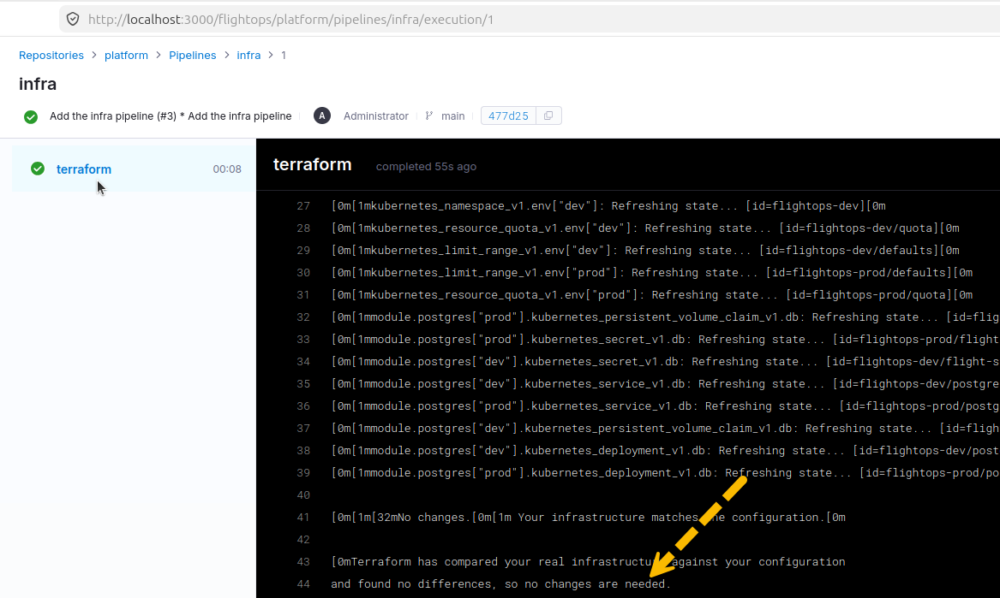

<!-- ui: view_execution flightops/platform infra -->

<!-- test
h_wait flightops/platform infra success
h_log flightops/platform infra plan | grep -q 'No changes'
-->

The `plan` step ends with:

```text
No changes. Your infrastructure matches the configuration.
```

The pipeline read the state from the cluster with its own credential, and found the infrastructure up to date.
The `apply` step shows as skipped. The event of this run is `manual`, and the step runs only for `push`.

## Part 5: Change infrastructure through a pull request

The development team needs more pods in dev.
You raise the dev pod quota from 10 to 12 through a pull request, so a reviewer sees the exact change before it reaches the cluster.

### 5.1 Make the change on a branch

```bash
cd ~/platform
git switch -c raise-dev-pods
sed -i 's/max_pods     = 10/max_pods     = 12/' variables.tf
git diff
```

```text
     dev = {
       cpu_limit    = "4"
       memory_limit = "4Gi"
-      max_pods     = 10
+      max_pods     = 12
     }
```

Check the change on your machine before you push it.
The same checks run in the pipeline, but finding a problem here is faster.

```bash
terraform fmt -check -recursive
terraform validate
terraform plan
```

The output at the end will look like the below one:

```text
...
....
Terraform will perform the following actions:

  # kubernetes_resource_quota_v1.env["dev"] will be updated in-place
  ~ resource "kubernetes_resource_quota_v1" "env" {
        id = "flightops-dev/quota"

      ~ spec {
          ~ hard   = {
              ~ "pods"          = "10" -> "12"
                # (2 unchanged elements hidden)
            }
            # (1 unchanged attribute hidden)
        }

        # (1 unchanged block hidden)
    }

Plan: 0 to add, 1 to change, 0 to destroy.
```

### 5.2 Push the branch and open a pull request

> [!CAUTION]
> `git commit -am` commits every modified file that Git already tracks, not only `variables.tf`. Run `git status --short` first. If it lists a file other than `variables.tf`, undo that change or stage the files by name.

```bash
git commit -am "Allow 12 pods in dev"
git push -u origin raise-dev-pods
```

You will see the output at the end like this:

```text
...
...
remote: Create a pull request for "raise-dev-pods" by visiting:
remote:   http://localhost:3000/flightops/platform/pulls/compare/main...raise-dev-pods
remote: 
To http://localhost:3000/git/flightops/platform.git
 * [new branch]      raise-dev-pods -> raise-dev-pods
branch 'raise-dev-pods' set up to track 'origin/raise-dev-pods'.
```

Open a pull request from `raise-dev-pods` to `main`, as in step 2.6:

1. In the Harness UI, open **Repositories** > **platform**. Select **Compare & pull request** in the banner for `raise-dev-pods`.
   If the banner is not there, open **Pull Requests** > **New Pull Request**, and choose `raise-dev-pods` as the source branch and `main` as the target.
2. Check that the title is `Allow 12 pods in dev`. Enter it if the field is empty.
3. Select **Create pull request**.

Do not merge yet. You review the plan in step 5.3 first.
The screenshots in step 2.6 show each screen if you need them.

<!-- ui: open_pr flightops/platform raise-dev-pods main "Allow 12 pods in dev" -->

The default trigger starts the `infra` pipeline for the pull request.

<!-- test
h_wait_pr_check flightops/platform infra success
h_log flightops/platform infra plan | grep -q '1 to change'
-->

### 5.3 Review the plan

On the pull request page, open the **Checks** tab (1). Select the `infra` check, then the `terraform` stage.
Read the log of the `plan` step (2). It ends with the plan:

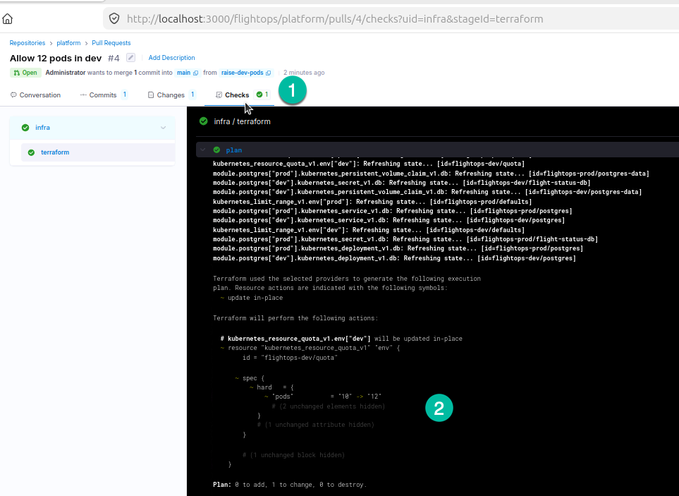

<!-- ui: view_pr flightops/platform -->

```text
  # kubernetes_resource_quota_v1.env["dev"] will be updated in-place
  ~ resource "kubernetes_resource_quota_v1" "env" {
      ~ spec {
          ~ hard = {
              ~ "pods"          = "10" -> "12"
                # (2 unchanged elements hidden)
            }
        }
    }

Plan: 0 to add, 1 to change, 0 to destroy.
```

A reviewer reads two things: the code change in **Files changed**, and the effect in the plan.
The plan matters more.
A one-line change to a variable can destroy and recreate a database, and only the plan shows that.
Look for `-` (destroy) and `-/+` (replace) on objects that hold data.

### 5.4 Merge

> [!IMPORTANT]
> The merge starts the `apply` step, which changes the real cluster. Squash and merge only after you have read the plan in step 5.3 and it shows the change you expect.

Merge the pull request as in step 2.6:

1. On the pull request page, open the **Conversation** tab and select **Squash and merge**.
2. In the dialog, select **Confirm Squash and merge**.
3. Check that the pull request shows **Merged**.

The screenshots in step 2.6 show each screen if you need them.

<!-- ui: merge_pr flightops/platform -->

The merge updates `main`, so the push trigger starts the pipeline again.
This time the event is `push` and the target is `main`, so the `apply` step runs.

<!-- test
h_wait flightops/platform infra success --branch main
h_log flightops/platform infra apply | grep -q '1 changed'
-->

Open the new run in **Pipelines** > **infra**. In the `terraform` stage, expand the **apply** step (1).

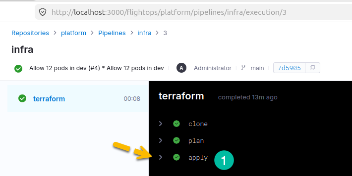

The log ends with the apply result and the outputs. Scroll to the end to find these lines:

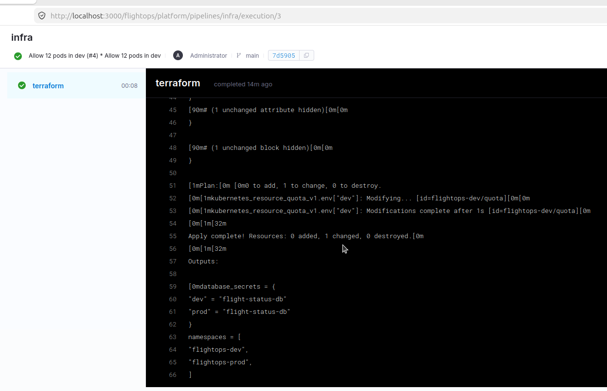

The important lines are:

```text
kubernetes_resource_quota_v1.env["dev"]: Modifying... [id=flightops-dev/quota]
kubernetes_resource_quota_v1.env["dev"]: Modifications complete after 0s [id=flightops-dev/quota]

Apply complete! Resources: 0 added, 1 changed, 0 destroyed.
```

### 5.5 Check the cluster and update your copy

```bash
kubectl -n flightops-dev get resourcequota quota -o jsonpath='{.spec.hard.pods}{"\n"}'
git switch main
git pull
git branch -D raise-dev-pods
git log --oneline -3
```

```text
12
Switched to branch 'main'
...
Deleted branch raise-dev-pods (was 8d2e4c1).
a71c9e0 Allow 12 pods in dev (#1)
3f0d7b2 Add the infra pipeline
9b1e6a4 Store Terraform state in the cluster
```

<!-- test
test "$(kubectl -n flightops-dev get resourcequota quota -o jsonpath='{.spec.hard.pods}')" = "12"
-->

The squash merge created a new commit on `main`, so Git does not see your branch as merged. `-D` deletes it anyway.

The change went from your machine to the cluster without anyone running `terraform apply` by hand.
The code review included the plan, and the apply used the pipeline's credential.
In the Harness platform, the same flow uses Terraform Plan and Terraform Apply steps, often with an Approval step between them.

## Part 6: Detect drift

### 6.1 Change the quota by hand

Someone raises the dev quota to 20 with kubectl, outside the pipeline:

```bash
kubectl -n flightops-dev patch resourcequota quota --type merge -p '{"spec":{"hard":{"pods":"20"}}}'
```

The output will be:

```text
resourcequota/quota patched
```

### 6.2 Run the pipeline

In the Harness UI, run the `infra` pipeline on `main` by hand, as in step 4.5.
On the **Executions** page of `infra`, select **Run** (1). In the **Run pipeline** dialog, keep the branch `main` and select **Run pipeline** (2).

<!-- shots:begin -->
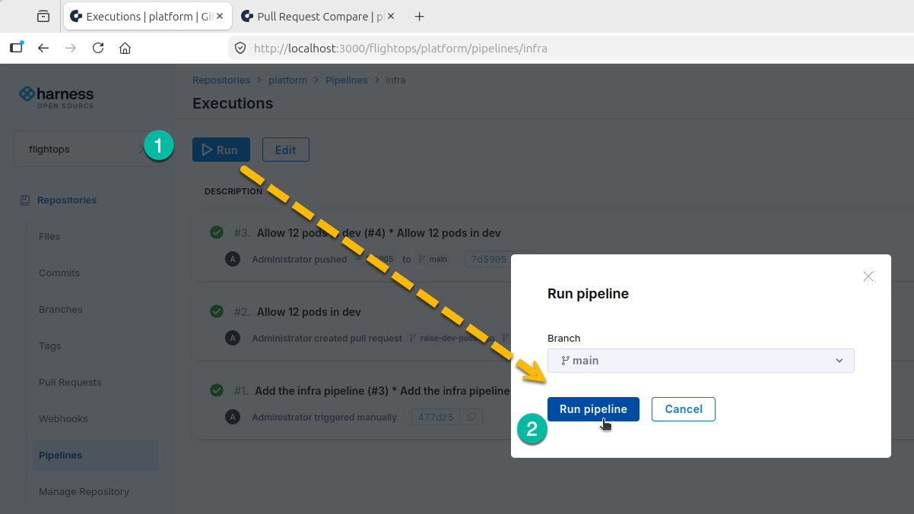
<!-- shots:end -->

<!-- ui: run_pipeline flightops/platform infra main -->

<!-- test
h_wait flightops/platform infra success
h_log flightops/platform infra plan | grep -q '1 to change'
-->

### 6.3 Read the plan

The `plan` step finds the difference:

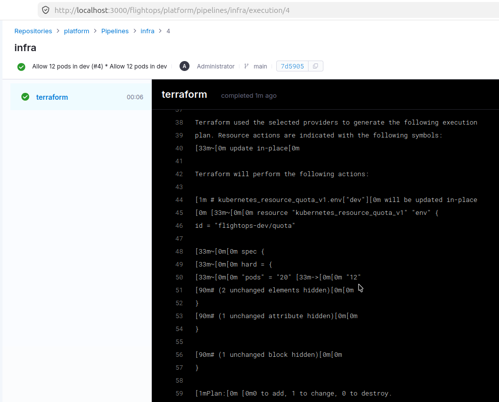

The key lines are:

```text
              ~ "pods"          = "20" -> "12"
...
Plan: 0 to add, 1 to change, 0 to destroy.
```

The run is green. A plan that contains changes is still a successful plan.
The apply step is skipped because this is a manual run.
The pipeline reported the drift without correcting it.

Many teams run such a plan on a schedule, for example every night, and alert when the plan is not empty.
`terraform plan -detailed-exitcode` exits with code 2 when there are changes, so a pipeline step can fail on drift.
The Harness platform has scheduled (cron) triggers for this. Harness Open Source 3.3.0 has no scheduled triggers.

### 6.4 Correct the drift

Bring the cluster back to the code.
Here you run Terraform from your machine. It uses the same state and the same lock as the pipeline.

```bash
cd ~/platform
terraform apply -auto-approve
kubectl -n flightops-dev get resourcequota quota -o jsonpath='{.spec.hard.pods}{"\n"}'
```

End of the output will look like the below one:

```text
...
...
Apply complete! Resources: 0 added, 1 changed, 0 destroyed.

Outputs:

database_secrets = {
  "dev" = "flight-status-db"
  "prod" = "flight-status-db"
}
namespaces = [
  "flightops-dev",
  "flightops-prod",
]
12

```

<!-- test
test "$(kubectl -n flightops-dev get resourcequota quota -o jsonpath='{.spec.hard.pods}')" = "12"
-->

In a team, you would usually re-run the pipeline on `main` with apply enabled, so the correction is recorded in the pipeline history too.

## Part 7: How locking works

Every Terraform command that can change the state first takes the lock.
For this backend, the lock is the Lease `lock-tfstate-default-platform`.
Terraform writes its own ID into the Lease and removes it when the run ends.

```bash
kubectl -n terraform get lease lock-tfstate-default-platform -o yaml
```

The output will look like:
```text
apiVersion: coordination.k8s.io/v1
kind: Lease
metadata:
  creationTimestamp: "2026-11-10T03:01:13Z"
  labels:
    app.kubernetes.io/managed-by: terraform
    tfstate: "true"
    tfstateSecretSuffix: platform
    tfstateWorkspace: default
  name: lock-tfstate-default-platform
  namespace: terraform
  resourceVersion: "28105"
  uid: fc0a8ca9-73cc-4993-8373-05f5bde8c383
spec: {}

```

While no run is active, the Lease has no holder.

If you want to see the lock work, use two terminals.
In the first terminal, start an apply that has a change to make, without `-auto-approve`, and leave it at the `Enter a value:` prompt.
A plain `terraform apply` will not work here, because with no changes it finishes without asking and never holds the lock.
The `-replace` flag forces a pending change, and Terraform holds the lock while it waits:

```bash
cd ~/platform && terraform apply -replace='module.postgres["dev"].random_password.db'
```

In the second terminal, try a plan that waits at most 10 seconds for the lock:

```bash
cd ~/platform && terraform plan -lock-timeout=10s
```

```text
Error: Error acquiring the state lock
...
Lock Info:
  ID:        f1b9c6e2-...
  Operation: OperationTypeApply
```

Then answer `no` in the first terminal. The lock is released.

> [!WARNING]
> Do not answer `yes`. The apply would generate a new dev database password and write it to the Secret `flight-status-db`, but the running PostgreSQL keeps the old password. In Lab 08 the flight status pods then fail with `password authentication failed for user "flights"`. If it already happened, see the Troubleshooting section of Lab 08.

The pipeline uses `-lock-timeout=60s`, so a run that starts while another run holds the lock waits up to a minute instead of failing at once.
`terraform force-unlock <ID>` removes a lock by hand. Use it only when you know that the run that took the lock has stopped.

## Troubleshooting

- **`terraform plan` after the migration wants to create every resource**: Terraform did not find the state. Check that `kubectl -n terraform get secret tfstate-default-platform` exists, and that `KUBE_CONFIG_PATH` is set. Do not apply this plan.
- **`terraform init` says `namespaces "terraform" not found`**: apply the bootstrap file first (step 1.2).
- **`Error: Backend initialization required`**: the backend configuration changed. Run `terraform init`.
- **`Error acquiring the state lock`**: another run holds the lock. Wait and try again. Use `terraform force-unlock` only if you are sure no run is active.
- **The pipeline's `plan` step fails with `Unauthorized`**: the `platform_kubeconfig` secret is incomplete or wrong. Copy the whole file again (step 3.4), then edit the secret in Harness and paste it.
- **The pipeline fails with `lookup k3d-devops-serverlb ... no such host`**: the step container is not on the `devops` network. Check that the `harness` container was started with `GITNESS_CI_CONTAINER_NETWORKS=devops` (Lab 01) and that the cluster is on that network (`docker network inspect devops`).
- **The pipeline fails at `terraform fmt -check`**: a file is not in standard format. Run `terraform fmt -recursive` in `~/platform`, commit and push.
- **The pull request shows no `infra` check**: the pipeline does not exist yet, or its default trigger is disabled. Check **Pipelines** > **infra** > **Settings** > **Triggers**.
- **The pipeline log shows codes such as `[33m` and `[0m` around the Terraform output**: the Harness log viewer does not render ANSI color codes, so Terraform's colors appear as raw text. The output is still correct. To remove the codes, add `TF_CLI_ARGS: "-no-color"` to the stage `envs` in `.harness/infra.yaml`, or add `-no-color` to the `terraform plan` and `terraform apply` commands. Commit and push the change as in step 4.2. If `terraform fmt` rejects the variable, use the per-command flag on `init`, `validate`, `plan` and `apply` only.
- **Harness still shows a `Compare & pull request` banner for a branch you already merged**: the banner appears for any recently pushed branch that has no open pull request, and a merged pull request is no longer open. Delete the remote branch and the banner goes away. From `~/platform`, run `git push origin --delete store-tf-state add-infra-pipeline raise-dev-pods`, then `git fetch --prune` to remove the stale `origin/...` references from your local copy. Deleting the remote branch loses nothing, because the squash merge already put the changes in `main`. You can also delete a branch in the UI: open **Branches**, select the `⋮` menu on the branch row, and select **Delete** (arrow), or select **Delete Branch** on the merged pull request.

  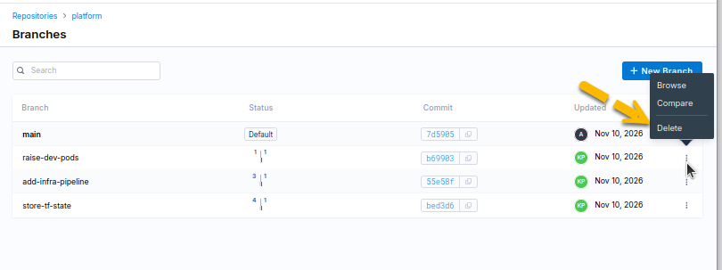

<!-- runner: stop -->

## Going further (optional)

- **Protect `main` in the platform repository.** Add a branch rule that requires a pull request and the `infra` check, as you did for `flight-status` in Lab 03. Infrastructure changes then always get a reviewed plan.
- **Fail on drift.** Create a second pipeline, `drift`, with one step that runs `terraform plan -detailed-exitcode -lock-timeout=60s`. Exit code 2 (changes present) fails the step. Run it after a manual `kubectl patch` and watch it fail.
- **Apply the reviewed plan without changes.** This pipeline plans again at merge time, so the applied plan can differ from the one in the review if the cluster changed in between. Read about saved plan files (`terraform plan -out=tfplan` and `terraform apply tfplan`) and think about where the pipeline would have to keep the file between the pull request run and the merge run.
- **Look at the state history.** The backend overwrites the same Secret on every apply. Compare this with an S3 backend with bucket versioning, which keeps every previous state.

## Summary

- You moved the state from a file on your machine into the cluster. It is shared, and a Lease locks it during each run (remote state and locking).
- You created the pipeline's identity outside Terraform, and kept that bootstrap file in Git.
- You stored the pipeline's kubeconfig as a Harness secret instead of in the repository.
- You changed infrastructure through a pull request: the pipeline planned on the pull request and applied after merge (plan on pull request, apply on merge).
- You used a pipeline run to detect drift, and corrected it from the same state.
